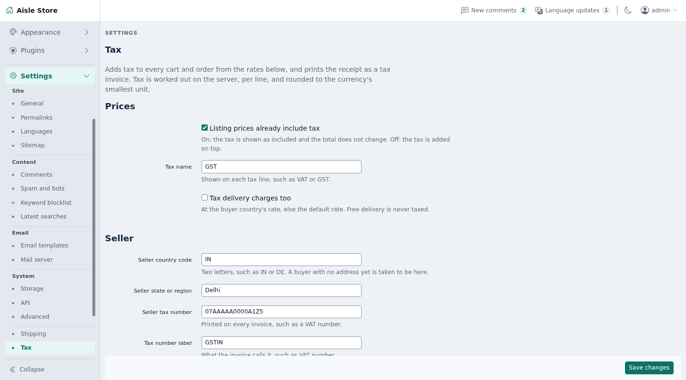

# Tax

Adds tax to every cart and order in a Shopclass shop, for any country. Set a default rate, rates by buyer country and rates by category. A paid order's receipt prints as a tax invoice.



## Requirements

- Shopclass 7.1.0 or later, with shop mode
- PHP 8.2 or later

Works on shared hosting. It needs no cron, worker, Redis or shell. On an older core it stays off and the admin sees a notice.

## Install

1. Open Plugins → Browse (or upload the zip from the GitHub release).
2. Install.
3. Activate.

## Set up

Open Billing → Tax.

1. Prices: turn on "Listing prices already include tax" (on by default), or leave it off to add tax on top. Set Tax name (such as VAT or GST). Turn on "Tax delivery charges too" to tax shipping.
2. Seller: set Seller country code, Seller state or region, Seller tax number and Tax number label.
3. Rates: set the Default rate, then optional rates by buyer country (code and percent) and by category (category, percent, optional tax code). Clear a row to remove it.
4. Invoice: set Invoice title and Invoice footer.

With no rate table saved, the plugin adds nothing.

## How it works

- Rate order: the line's category rate (a subcategory uses its nearest parent's), then the buyer country's rate, then the default.
- A buyer with no address yet counts as in the seller's country and state.
- Delivery, when taxed, uses the buyer country's rate, else the default. Free delivery is never taxed.
- Prices include tax: tax = price − price × 100 / (100 + rate). The total does not change and checkout shows "Includes …".
- Tax on top: tax = price × rate / 100, added to the total.
- Tax is worked out once per cart line, never per unit. It is rounded half up to the currency's smallest unit.
- There is one tax line per rate, such as `tax.gst.18` "GST 18%". Its meta holds `bp` (basis points), `part`, `base`, `included` and the cart `lines` it covers.
- Tax is worked out on the prices after discounts: core runs `cart_discount_lines` first, and a cart discount is shared over the items and shipping by value. On an older core that taxes first, a discounted order's invoice says so.
- All amounts are computed on the server from core's cart. Nothing in the request sets a rate or amount.
- Invoice: when an order carries this plugin's tax, its receipt becomes a tax invoice. It shows your title (default "Tax invoice"), tax number, place of supply (buyer's state and country), taxable value and tax codes per rate, and your footer.

## Notes / limits

- Up to 20 tax lines per cart (distinct rates × parts).
- Up to 250 country rates and 500 category rates.
- Rates run from 0% to 100%, with up to two decimals.
- No buyer tax number at checkout, no invoice numbering of its own (the invoice shows the order number) and no PDF. The receipt page prints.
- Settings are preferences in the `tax` section. No table of its own. A placed order keeps its tax lines.
- Uninstalling removes the settings. Orders keep the tax lines they were charged.
- Queries: none per quote without category rates. With category rates, one primary-key query per request.

## For developers

Listens to the filters `cart_tax_lines` and `billing_receipt_details`. Fires three filters. A return value of the wrong shape is ignored.

`$context`, passed to each:

```php
array(
    'seller_country' => 'IN',   'seller_state' => 'Delhi',
    'country'        => 'IN',   'state'        => 'Maharashtra', 'postcode' => '400001',
    'same_country'   => true,   'same_state'   => false,  // compared without case or extra spaces
    'inclusive'      => true,   'currency'     => 'INR',  'user_id' => 12,
)
```

`tax_line_rate` `($rate, $line, $context)` changes the rate of one line. `$rate` is `array('bp' => 1800, 'code' => '6109'|null, 'source' => 'category'|'country'|'default')`. `$line` is `array('kind' => 'item'|'shipping', 'line', 'item_id', 'category_id', 'title', 'qty', 'amount')`. Return `array('bp' => int 0–10000, 'code' => ?string)`.

```php
osc_add_filter('tax_line_rate', function ($rate, $line, $context) {
    return $line['kind'] === 'shipping' ? array('bp' => 0, 'code' => null) : $rate;
});
```

`tax_parts` `($parts, $context)` splits a tax into parts. Default: `array(array('id' => 'gst', 'label' => 'GST', 'share' => 10000))`. Return 1 to 4 parts. Each has an `id` (a–z, 0–9, up to 16), a `label` and a whole `share` in basis points. Shares must sum to 10000. Each line's tax is split by largest remainder, so parts add up to the whole.

```php
osc_add_filter('tax_parts', function ($parts, $context) {
    return $context['same_state']
        ? array(array('id' => 'cgst', 'label' => 'CGST', 'share' => 5000), array('id' => 'sgst', 'label' => 'SGST', 'share' => 5000))
        : array(array('id' => 'igst', 'label' => 'IGST', 'share' => 10000));
});
```

`tax_invoice` `($invoice, $order, $context)` edits the invoice. `$invoice` holds `title`, `tax_id_label`, `tax_id`, `place_label`, `place_of_supply`, `code_label` (default "Tax code"), `rates` (per tax line: `label, bp, part, base, tax, included, codes`), `discounted`, `extra`, `summary` and `footer`. Change labels, or append `array('label' => …, 'value' => …)` rows to `extra` (under the seller block) or `summary` (under the lines).

```php
osc_add_filter('tax_invoice', function ($invoice, $order, $context) {
    $invoice['code_label'] = 'HSN';
    $invoice['extra'][]    = array('label' => 'State code', 'value' => '07');

    return $invoice;
});
```

The India GST split is the separate Tax GST plugin, built on these filters.

Tests: `./tests/run.sh` (unit), or `SHOPCLASS_CORE=../shopclass DRIFT_DB_PORT=33061 ./tests/run.sh` to add the integration test. Regenerate the template with `php tools/make-pot.php`.

## Support

https://github.com/mindstellar/shopclass-plugin-tax/issues

## License

GPL-3.0-or-later. See [LICENSE](LICENSE).
